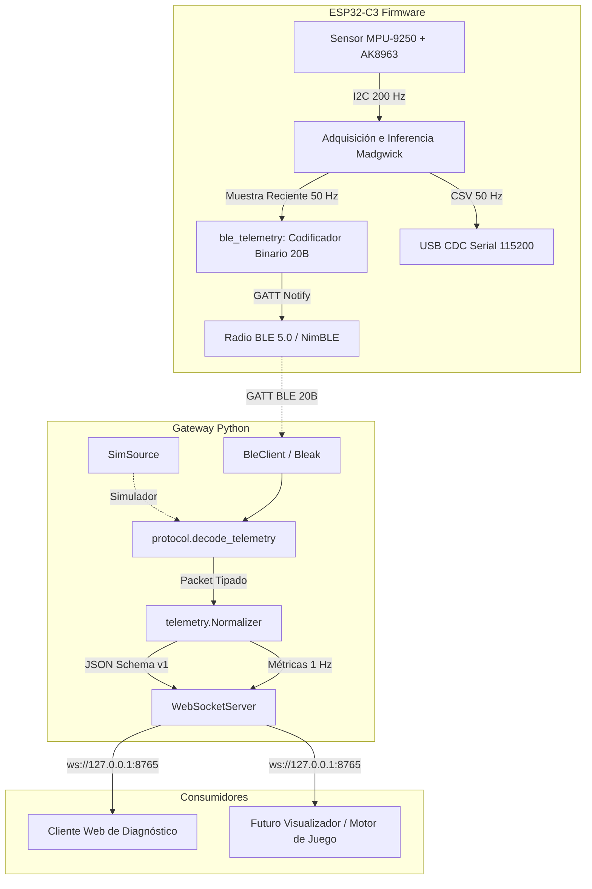

# Arquitectura del Sistema — Motion Controller Lab

El proyecto implementa un pipeline desacoplado en capas para transportar la orientación calculada por un microcontrolador ESP32-C3 hacia aplicaciones de visualización y motores de juego.

---

## 1. Principios de Diseño

1. **Separación Estricta de Responsabilidades:**
   - El firmware adquiere a 200 Hz, ejecuta el algoritmo de fusión Madgwick 9-DOF MARG con corrección de magnetómetro AK8963 (remapeado a terna de cuerpo $X_{body}=Y_{mag}, Y_{body}=X_{mag}, Z_{body}=-Z_{mag}$) y cuenta con fallback transparente a 6-DOF gobernado por un watchdog de caducidad de 50 ms.
   - El gateway no recalcula ni filtra orientación: solo transporta, valida, desenrolla secuencia, mide calidad del enlace y normaliza a JSON.
   - Los clientes finales (visualizadores o juegos) consumen datos listos para usar sin conocer BLE ni detalles de registros I2C.
2. **Priorización de Datos en Tiempo Real (Latest-Sample):**
   - El firmware adquiere a 200 Hz y decima 4:1 para emitir notificaciones BLE a 50 Hz con la muestra más reciente.
   - En el gateway, cada cliente WebSocket posee un `ClientSlot` acotado con `maxsize=1`: si un cliente es lento leyendo, las muestras intermedias se descartan inmediatamente y se entrega siempre la última orientación calculada, eliminando fugas de memoria.
3. **Eficiencia en el Ancho de Banda BLE:**
   - La telemetría completa viaja en paquetes compactos de exactamente 20 bytes (encapsulados dentro del MTU mínimo ATT de 23 bytes).
   - El cuaternión absoluto se comprime con el algoritmo *smallest-three* en 32 bits con error angular medio de 0.08° y peor caso < 0.28° (holgadamente dentro del límite contractual de < 0.5°).
   - Rendimiento neto: 1.0 KB/s a 50 Hz, consumiendo una fracción mínima de la capacidad del canal BLE.
4. **Resiliencia y Recuperación:**
   - Desconexiones de BLE o de clientes WebSocket no reinician el sensor ni el filtro inercial.
   - El gateway reconecta automáticamente mediante retroceso exponencial (1s a 30s con jitter).
   - Los reinicios del dispositivo se detectan cuando la secuencia experimenta un salto negativo mayor a 1000 muestras.
