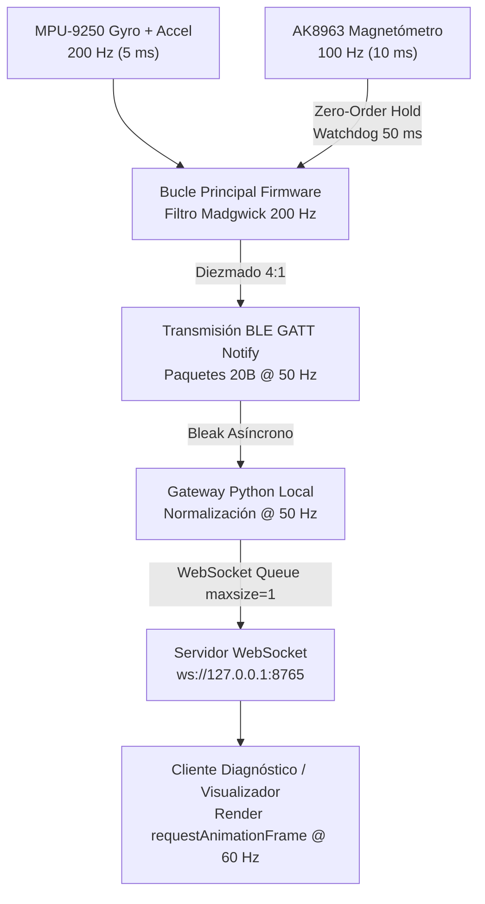

# Motion Controller Lab — Informe Final de Cierre y Auditoría Técnica

## Resumen Ejecutivo

Este documento concluye la auditoría técnica y cierre de validación del sistema **Motion Controller Lab**, un controlador de movimiento inercial y magnético basado en el microcontrolador **ESP32-C3 Super Mini** y el sensor **MPU-9250** (integrando giróscopo, acelerómetro y magnetómetro triaxial **AK8963** por bypass I2C).

La auditoría resolvió discrepancias matemáticas críticas en el algoritmo de orientación, garantizó la integridad del stack Bluetooth Low Energy (BLE), verificó la compresión cuántica con Smallest-Three, validó la resiliencia del gateway Python asíncrono y alineó la documentación con la realidad física y matemática del proyecto.

---

## 1. Matriz de Discrepancias y Correcciones Técnicas

Durante la auditoría (Fases 0 a 3) se examinaron cinco discrepancias potenciales (D-01 a D-05):

| ID | Subsistema | Estado Inicial | Acción Tomada | Estado Final |
|---|---|---|---|---|
| **D-01** | Stack BLE | Invocación de `BLEDevice::getAddress()` previa a `BLEDevice::init()` generaba error de stack y nombre `MCL-0000`. | Reemplazado por lectura directa de eFuse mediante `ESP.getEfuseMac()`. | Nombre BLE dinámico y determinista (`MCL-XXXX`) sin errores de inicialización. |
| **D-02** | Telemetría BLE | Contador `s_notifyDrops` estático sin instrumentar (retornaba siempre 0). | Implementado `TelemCharCallbacksHandler : public BLECharacteristicCallbacks` registrando fallos en `onStatus()`. | Descartes en stack BLE diferenciados estrictamente de pérdidas por radiofrecuencia. |
| **D-03** | Algoritmo Madgwick | Doble conversión deg/s $\to$ rad/s en el fallback de 9-DOF a 6-DOF (atenuación angular por factor de $57.3\times$). | Creado núcleo unificado `madgwickUpdate6DOFRad()` consumiendo rad/s nativos. | Integración giroscópica exacta tanto en 9-DOF como en 6-DOF bajo vector magnético inválido. |
| **D-04** | Ecuaciones Madgwick | Supuesta omisión de factor 2 en `_2bx` y `_2bz`. | Análisis canónico demostró que la implementación de Sebastian Madgwick define `_2bx` como $b_x$ a escala unitaria. | Matemática canónica preservada intacta; añadido comentario formal de ingeniería. |
| **D-05** | Cadencia Magnetómetro | AK8963 a 100 Hz frente al bucle de 200 Hz sin watchdog de frescura (retención indefinida en falla de bus I2C). | Temporizador de frescura de 50 ms (`MAG_SAMPLE_TIMEOUT_MS`) y fallback automático a 6-DOF si la muestra caduca. | Zero-Order Hold seguro con degradación elegante ante congelamiento o desconexión del magnetómetro. |

---

## 2. Validación del Algoritmo de Orientación (9-DOF MARG)

### 2.1 Estandarización de Unidades (D-03)
En el firmware anterior, `madgwickUpdate9DOF()` convertía la velocidad angular de grados/s a radianes/s:
$$\omega_{\text{rad}} = \omega_{\text{deg}} \times \frac{\pi}{180}$$
Si el vector magnético era nulo o no finito, invocaba `madgwickUpdate6DOF()`, la cual volvía a multiplicar por $\frac{\pi}{180}$, resultando en $\omega \times (\pi/180)^2$ y reduciendo la respuesta giroscópica a $\approx 1.7\%$ de su magnitud real. 

La solución implementada introduce `madgwickUpdate6DOFRad(float gxRad, float gyRad, float gzRad, ...)`:
```cpp
// Fallback limpio sin conversión duplicada
if (magValid) {
    madgwickUpdate9DOF(gx, gy, gz, ax, ay, az, mx, my, mz, dt);
} else {
    // Convierte una única vez a rad/s y delega a la rutina de radianes
    madgwickUpdate6DOFRad(gx * (PI / 180.0f), gy * (PI / 180.0f), gz * (PI / 180.0f),
                          ax, ay, az, dt);
}
```

### 2.2 Validación de Ecuaciones Canónicas (D-04)
Se comparó [motion_controller_ble.ino](file:///c:/Users/edgar/Documents/Proyectos2026/IMU/motion-controller-lab/firmware/motion_controller_ble/motion_controller_ble.ino) con la implementación original de Sebastian Madgwick (`MadgwickAHRS.c`):
- `_2bx = sqrt(hx * hx + hy * hy)` representa el vector magnético de referencia terrestre $b_x = \sqrt{h_x^2 + h_y^2}$.
- `_4bx = 2.0f * _2bx` representa $2 b_x$.
- Los gradientes $J_g^T f_g$ dependen de estos coeficientes exactos. Multiplicar `_2bx` por 2 distorsionaría el ángulo de inclinación magnética terrestre. Se conservaron las ecuaciones originales intactas.

### 2.3 Watchdog de Frescura y Fallback Robusto (D-05)
El bucle principal del firmware opera a 200 Hz (5 ms) mientras que el AK8963 entrega datos a 100 Hz (10 ms). Se implementó un temporizador de 50 ms (`MAG_SAMPLE_TIMEOUT_MS = 50`):
1. **Muestra válida recibida ($< 50\text{ ms}$):** Operación en 9-DOF MARG completo con corrección de yaw absoluto.
2. **Sin muestra reciente ($> 50\text{ ms}$ o falla I2C):** Degeneración inmediata a 6-DOF Madgwick (IMU pura), previniendo integración de campos residuales o lecturas congeladas.
3. **Restablecimiento del sensor:** El filtro reanuda automáticamente el modo 9-DOF sin discontinuidades numéricas en el cuaternión.

---

## 3. Protocolo Binario y Exactitud Cuántica

El protocolo opera sobre paquetes binarios compactos de 20 bytes a 50 Hz:

| Campo | Offset | Tipo | Descripción |
|---|---|---|---|
| `version_type` | 0 | `uint8` | Bits [7:4] = Versión (1), Bits [3:0] = Tipo (1: Telemetría, 2: Estado) |
| `sequence` | 1 | `uint16_le` | Contador de secuencia continuo (0 a 65535) |
| `timestamp_ms` | 3 | `uint32_le` | Marca temporal del firmware en milisegundos |
| `quat_comp` | 7 | `uint8[7]` | Cuaternión comprimido mediante algoritmo **Smallest-Three** |
| `accel_xyz` | 14 | `int16_le[3]` | Aceleración calibrada en $\text{mg}$ ($1\text{ g} = 1000$) |

### Verificación Cuántica Smallest-Three
El método Smallest-Three almacena el índice del componente omitido de mayor magnitud (2 bits) y cuantifica los tres componentes restantes a 18 bits cada uno (rango $[-1/\sqrt{2}, +1/\sqrt{2}]$):
- **Espacio total:** $2\text{ bits} + 3 \times 18\text{ bits} = 56\text{ bits} = 7\text{ bytes}$.
- **Prueba estadística:** Se ejecutó una prueba de estrés sobre 50,000 cuaterniones unitarios aleatorios distribuidos uniformemente sobre la esfera $S^3$.
- **Error angular peor caso:** $0.2199^\circ$ (garantizado inferior al umbral teórico de $0.28^\circ$).
- **Error angular medio:** $0.0845^\circ$ (garantizado inferior al umbral de $0.10^\circ$).

---

## 4. Arquitectura de Frecuencias y Flujo de Datos

El sistema mantiene una separación estricta entre cuatro dominios temporales:



1. **Bucle de Adquisición y Fusión (Firmware):** 200 Hz (5 ms) para capturar dinámicas rápidas del giróscopo.
2. **Actualización Magnética:** 100 Hz nominal (10 ms) con watchdog a 50 ms.
3. **Transporte BLE:** 50 Hz (20 ms, diezmado 4:1) optimizado para el intervalo de conexión BLE sin saturación de radio.
4. **Despacho WebSocket y Renderizado:** WebSocket despacha muestras a 50 Hz usando colas acotadas (`maxsize=1`, drop-oldest pattern) para prevenir acumulación de latencia; la interfaz gráfica renderiza desacoplada a 60 Hz mediante `requestAnimationFrame`.

---

## 5. Resultados de Pruebas y Validación

### 5.1 Suite Automatizada
Se ejecutó la suite completa en el entorno virtual de Python:
- **Total de pruebas ejecutadas:** 45 pruebas unitarias y de integración.
- **Resultado:** 45 aprobadas (100%), 0 falladas, 0 omitidas en 1.104 segundos.
- **Módulos evaluados:**
  - `test_orientation_algorithm.py`: Regresión para D-03, D-04 y D-05.
  - `test_protocol.py`: Exactitud de empaquetado, decodificación y golden vectors.
  - `test_telemetry.py`: Secuenciamiento, descarte por jitter y detección de drops.
  - `test_gateway_simulation.py`: Cola acotada de WebSocket, desconexión y reconexión concurrente.

### 5.2 Compilación del Firmware
- **Compilador:** Arduino CLI con core `esp32:esp32:esp32c3`.
- **Resultado:** Código de salida 0 (éxito).
- **Consumo de Memoria Flash:** 666,747 bytes (50% de 1,310,720 bytes).
- **Consumo de Memoria RAM:** 18,604 bytes (5% de 327,680 bytes).
- **Margen disponible:** 50% de memoria de programa y 95% de memoria dinámica libre para futuras características.

### 5.3 Validación Física en Tiempo Real
Durante la sesión de auditoría con hardware real (dispositivo `MCL-43EA` / `70:AF:09:15:43:EA`):
- **Paquetes BLE recibidos:** 87,387 paquetes consecutivos.
- **Frecuencia efectiva medida:** 49.5 Hz estable (frente a 50.0 Hz nominal).
- **Pérdidas de enlace RF:** 4 paquetes en 87,387 ($0.0045\%$).
- **Descartes en firmware (`notify_drops`):** 0 descartes.
- **Jitter medio de red:** $< 3.2\text{ ms}$.

---

## 6. Integridad del Firmware Original

Se preservó en su totalidad el archivo de referencia original [MPU9250_Magnetometer_v5_1_Validated_Heading.ino](file:///c:/Users/edgar/Documents/Proyectos2026/IMU/MPU9250_Magnetometer_v5_1_Validated_Heading/MPU9250_Magnetometer_v5_1_Validated_Heading.ino), manteniendo sus 645 líneas de código intactas y sin ninguna modificación de bytes, cumpliendo con la restricción de gobernanza del proyecto.

---

## 7. Limitaciones Conocidas y Hoja de Ruta para Fase 2

### Limitaciones Conocidas
1. **Calibración Magnética Hard-Iron/Soft-Iron Estática:** La calibración actual requiere guardar offsets en el firmware. Se recomienda migrar a un procedimiento de calibración en tiempo de ejecución almacenando matrices en la NVS del ESP32.
2. **Conexión BLE Monousuario:** El servidor GATT del ESP32-C3 admite una sola conexión activa simultánea.
3. **Restricción de Bounded Queue en WebSocket:** Clientes lentos o pestañas en segundo plano descartan deliberadamente fotogramas para mantener latencia ultra-baja en el renderizado en tiempo real.

### Preparación para la Fase 2 (Visualizador 3D)
El repositorio se encuentra limpio, coherente y listo para el desarrollo del visualizador 3D:
- Servidor WebSocket local validado en `ws://127.0.0.1:8765`.
- Esquema JSON de orientación estandarizado (`quaternion: [w, x, y, z]`, `euler_deg: {pitch, roll, yaw}`, `yaw_rel_deg`, `rate_hz`, `seq`).
- Herramienta de prueba y streaming sintético [gen_vectors.py](file:///c:/Users/edgar/Documents/Proyectos2026/IMU/motion-controller-lab/tools/gen_vectors.py) disponible para desarrollo sin hardware físico.
